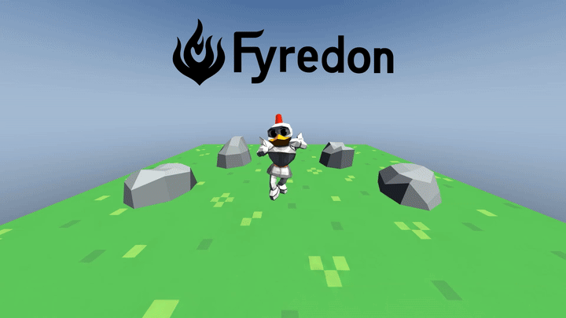
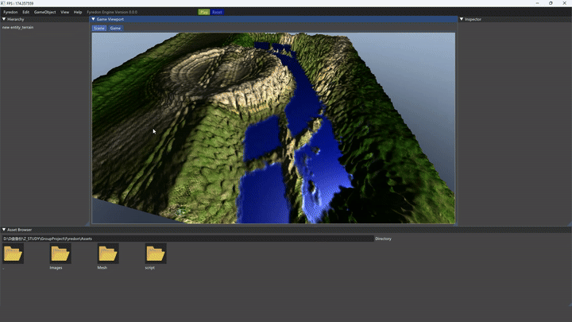
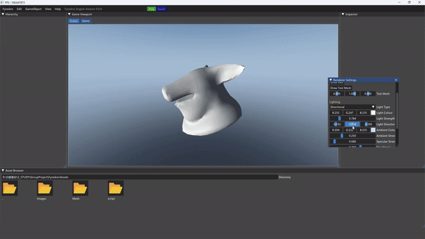
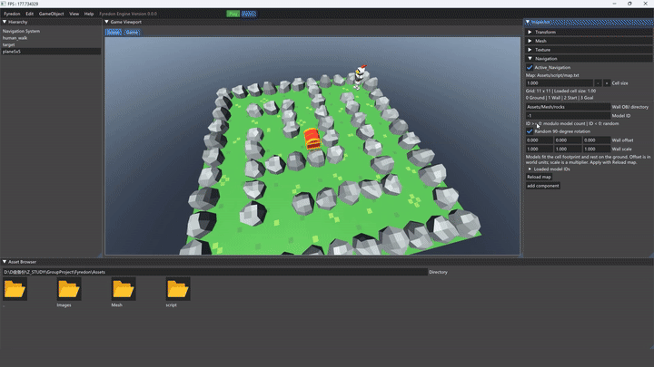
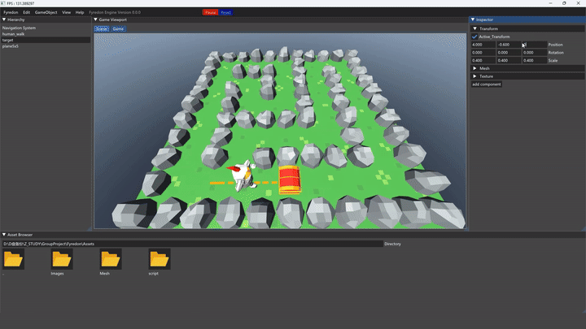

  

# Fyredon Engine

**A lightweight 3D game engine built with C++, OpenGL, and Dear ImGui.**

Fyredon Engine is a university group project built around an Entity Component System (ECS) architecture. It brings together a custom rendering pipeline, an interactive scene editor, skeletal animation, texture and lighting controls, and character navigation.

The editor supports loading OBJ and FBX assets, organizing scene entities, and editing transforms, meshes, textures, and animation settings at runtime. The demos show these systems working together, from an animated character scene to a configurable navigation map with a fullscreen game preview.

This repository continues the [original Team Fyredon project on GitLab](https://gitlab.com/sc18ijf/comp5530m-group-project-team-fyredon-game-engine). Team authorship is retained in the imported history; ongoing development is on **personal-dev**. See [migration details](docs/MIGRATION.md) for the repository history.

**[Watch the full demo on YouTube](https://youtu.be/Z4Vq_VIWXGY)**

## Key Features

- **ECS architecture:** Entities and components organize scene objects and their behaviour.
- **Scene editor:** Dear ImGui panels include Hierarchy, Inspector, Asset Browser, Game Viewport, and optional Renderer Settings.
- **Asset loading:** Load or replace OBJ and FBX models through the Mesh component. Browse asset folders by double-clicking their icons.
- **Textures:** Enable or disable a texture, enter its file path, and adjust UV offset and scale.
- **Rendering and lighting:** OpenGL rendering with depth testing and multisample rendering, point or directional lighting, ambient and specular controls, and a solid or gradient sky background.
- **Skeletal animation:** Autodesk FBX SDK imports skinned meshes and animation clips. The Animation component provides playback, speed, frame-range, and frame-scrubbing controls.
- **Navigation:** A* pathfinding on a configurable grid, text-file maps, mesh-based obstacles, and movement-controlled walking animation.
- **Path debugging:** An optional orange dashed route visualizes the A* result.
- **Game preview:** A separate borderless fullscreen window starts Play and displays only the rendered scene. Closing it restores the editor and its previous playback state.

## Demos

### Character Animation

**GameObject → Dance Demo** creates a textured ground plane, four independent rock entities, and the animated MC_dance.fbx character. Animation can be controlled from the Animation component or the global Play controls.

### ECS and Terrain Editing

Select objects in the Hierarchy and edit their components in the Inspector. The Navigation Demo builds a ground plane and a grid map with a character, a treasure-chest target, and rock obstacles.

The Navigation component controls cell size, the wall-model directory, model selection, random quarter-turn rotation, and wall offset and scale. Apply map and wall-generation changes with **Reload map**.

### Textures and Lighting

Use each object's Texture component to change textures and UV transforms. Open **View → Renderer Settings** to adjust lighting, background colours, grid visibility, and axis visibility.

### Navigation and Scene Debugging

**GameObject → Navigation Demo** loads a text-defined map and places the character and target in their designated cells. Press **Play** to start navigation. Walking animation runs while the character moves and stops when it reaches its destination.

Enable the **Debug** component on the **Navigation System** entity to show the computed A* route. The dashed line represents the grid path; the character's steering can cut across corners while following it.

### Fullscreen Runtime Preview

Choose **View → Preview** to run the current scene in a separate fullscreen window. The editor is hidden and its viewport input is inactive during preview.

Press **Esc**, use **Alt+F4**, or close the preview window to return to the editor. Scene progress is retained, and the pre-preview Play/Pause state is restored.

## Development Environment

- **Platform:** Windows x64.
- **Compiler:** Visual Studio C++ desktop development tools with the **MSVC v142** toolset.
- **Windows SDK:** A compatible Windows 10 SDK; Premake selects the latest installed version. The local build has used 10.0.19041.0.
- **Graphics:** An OpenGL 4.5-capable GPU and driver.
- **Source control:** Git and Git LFS.
- **Dependencies:** GLEW, GLFW, GLM, Dear ImGui, Autodesk FBX SDK 2020.2.1, and other bundled headers and libraries in **Extern/**.
- **Project generation:** The bundled Premake executable generates a Visual Studio 2019 solution.

## Build and Run

Clone the active development branch and download LFS-managed assets:

~~~powershell
git lfs install
git clone --branch personal-dev https://github.com/ShawnYangCG/Fyredon.git
cd Fyredon
git lfs pull
~~~

From PowerShell in the repository root, build the application:

~~~powershell
.\build-local.ps1
~~~

The script generates the Visual Studio solution, builds **Release | x64**, and places the executable, engine library, and required FBX runtime DLL in the repository's **Debug/** folder. Despite its name, this output folder is also used for Release builds. Intermediate build files remain inside the project.

Run with **Debug/** as the working directory so the relative asset and shader paths resolve:

~~~powershell
Set-Location .\Debug
.\Client.exe
~~~

For a Debug configuration, run the following from the repository root:

~~~powershell
.\build-local.ps1 -Configuration Debug
~~~

### Editor Controls

| Action | Control |
| --- | --- |
| Move the editor camera forward/backward | Mouse wheel over the Scene viewport |
| Change the camera's viewing direction | Middle mouse drag |
| Pan the camera | Shift + middle mouse drag |
| Enter an asset folder / return to its parent | Double-click its icon / the .. icon |
| Create a demo | GameObject → Navigation Demo or Dance Demo |
| Run, pause, or reset the scene | Play, Pause, and Reset controls |
| Show lighting and background settings | View → Renderer Settings |
| Enter fullscreen runtime preview | View → Preview |
| Return from preview | Esc or close the preview window |

## Navigation Map Format

Edit **Assets/script/map.txt** to change the map without recompiling. The file contains a square grid:

| Value | Meaning |
| --- | --- |
| 0 | Walkable ground |
| 1 | Wall |
| 2 | Character start — exactly one |
| 3 | Target — exactly one |

Separate columns with commas and rows with semicolons. Newlines are for readability and do not define row boundaries.

~~~text
1,1,1,1,1;
1,2,0,0,1;
1,0,1,0,1;
1,0,0,3,1;
1,1,1,1,1;
~~~

The grid expands around the world origin. **Cell size** controls its spacing in world units. After editing the file, select the ground entity's Navigation component and click **Reload map**.

Wall meshes are loaded from the configured OBJ directory, initially **Assets/Mesh/rocks**. Files are sorted by filename and assigned zero-based IDs. A non-negative **Model ID** wraps modulo the number of available models; a negative value selects a random model for each wall cell. Optional random rotation chooses one of four quarter-turn orientations. Wall choices and transforms are regenerated only when the map is reloaded.

## Folder Structure

~~~text
Assets/
  Mesh/              OBJ and FBX models, including characters and rocks
  Images/            Textures, UI icons, logo, and demo GIFs
  script/map.txt     Editable navigation map
Client/              Application entry point and client configuration
Fyredon/
  Include/           Engine headers
  Source/            Engine, ECS, editor, rendering, and animation implementation
Shaders/             OpenGL shader programs
Extern/              Third-party headers and binary dependencies
premake/             Bundled project-generation tool
Debug/               Local executable, runtime DLLs, build logs, and intermediate files
tests/               Component and runtime regression checks
tools/               Asset-processing utilities, including FBX UV transfer
docs/                Repository migration history and commit mapping
Licenses/            Third-party license files
Out/                 Legacy engine output and saved state
build-local.ps1      Local Windows build script
~~~
